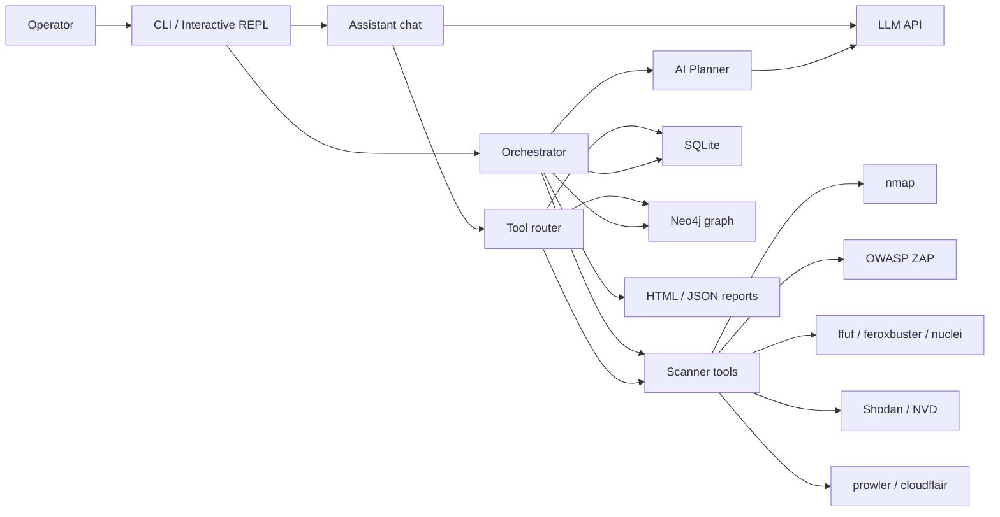
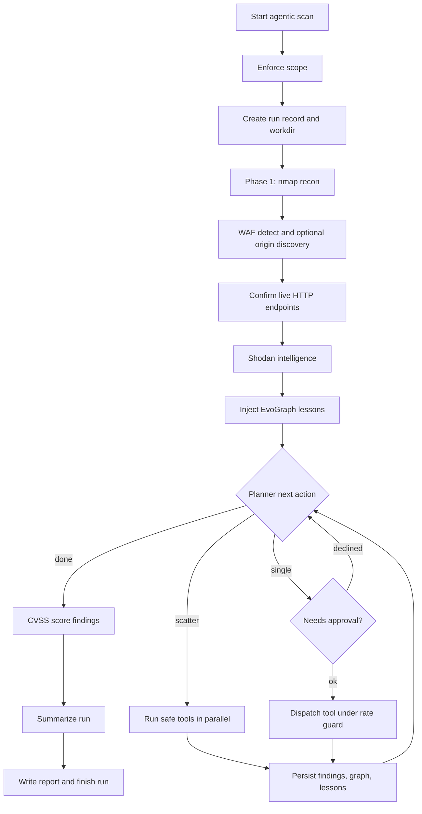
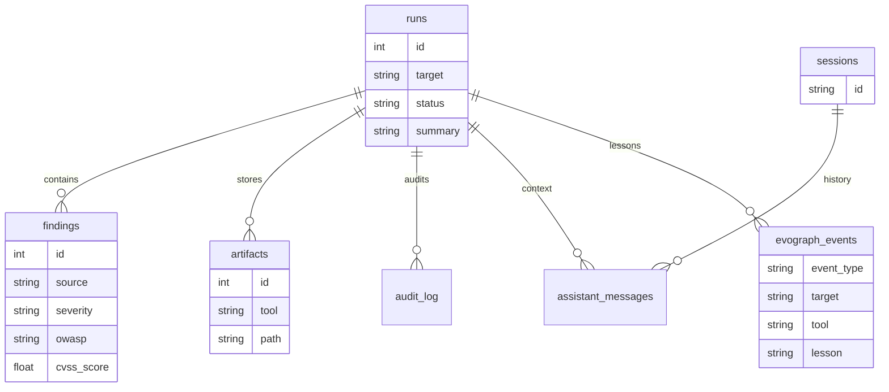
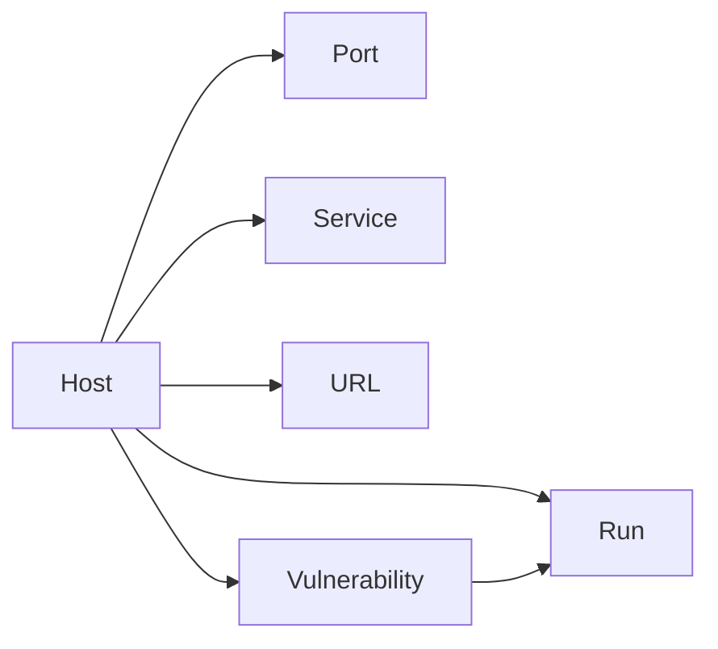

# Pentest Bot T800 — Architecture

High-level layout of the AI-driven pentest orchestrator: entry surfaces, the agentic scan loop, persistence, and how findings flow into reports and the attack-surface graph.

## System Context

Who talks to the bot, and what external systems it depends on.



## Component Map

Internal packages and how they collaborate during a run.

```mermaid
flowchart TB
  subgraph entry [Entry]
    mainEntry["__main__"]
    cliMod["cli"]
  end

  subgraph core [Core control plane]
    orch["orchestrator"]
    scope["ScopeGuard"]
    jobs["JobManager"]
    session["SessionManager"]
  end

  subgraph aiLayer [AI layer]
    plannerMod["Planner"]
    recovery["FailureRecovery"]
    assistantMod["Assistant"]
    router["tool_router"]
    client["AIClient"]
    summarizer["summarizer"]
    cvss["CVSS scorer"]
  end

  subgraph tools [Tool adapters]
    schema["ToolResult / ScanState"]
    rateGuard["RateLimitDetector"]
    cache["ToolResultCache"]
    adapters["nmap zap ffuf nuclei sqlmap ..."]
  end

  subgraph data [Persistence and output]
    db["SQLite DB"]
    evo["EvoGraph lessons"]
    graph["GraphDB Neo4j"]
    reporting["normalize + render"]
  end

  mainEntry --> cliMod
  cliMod --> orch
  cliMod --> assistantMod
  cliMod --> session
  orch --> scope
  orch --> plannerMod
  orch --> recovery
  orch --> jobs
  orch --> adapters
  orch --> rateGuard
  orch --> cache
  orch --> db
  orch --> evo
  orch --> graph
  orch --> summarizer
  orch --> cvss
  orch --> reporting
  plannerMod --> client
  assistantMod --> client
  assistantMod --> router
  router --> db
  router --> graph
  router --> jobs
  adapters --> schema
```

## Agentic Scan Flow

Mandatory recon, then plan → execute → learn until done, followed by scoring and reporting.



## Persistence Model

SQLite is the system of record; Neo4j is an optional attack-surface mirror.



## Attack Surface Graph

Optional Neo4j shape synced after each tool result.


